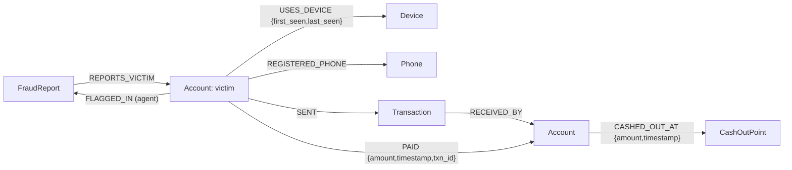

# MuleTrace — Graph Schema

Graph: `muletrace` (FalkorDB). This schema is designed so every tool in `TOOLS.md` and
the demo story in `DEMO_SCRIPT.md` can be expressed directly.

Ground-truth labels (`ring_id`, `is_planted_mule`) are **never** stored as graph
properties — they live only in a separate test file so the agent cannot cheat.

## a) Node labels & properties

| Label | Property | Type | Notes |
| --- | --- | --- | --- |
| `Account` | `id` | string | unique key |
| | `holder_name` | string | |
| | `bank` | string | |
| | `account_type` | string | `individual \| merchant \| mule_suspect` |
| | `opened_at` | integer | epoch seconds |
| | `balance_held` | number | money currently sitting in the account |
| | `is_flagged` | boolean | |
| | `risk_score` | number | default `0` |
| `Device` | `id` | string | |
| | `device_fingerprint` | string | |
| | `os` | string | |
| `Phone` | `id` | string | |
| | `number` | string | unique per phone |
| `Transaction` | `id` | string | |
| | `amount` | number | |
| | `timestamp` | integer | epoch seconds |
| | `channel` | string | `UPI \| IMPS \| NEFT \| ATM \| CRYPTO` |
| | `status` | string | e.g. `SUCCESS`, `FAILED` |
| `CashOutPoint` | `id` | string | |
| | `kind` | string | `ATM \| CRYPTO_EXCHANGE \| WALLET` |
| | `name` | string | |
| | `location` | string | |
| `FraudReport` | `id` | string | |
| | `victim_account_id` | string | link to `Account.id` |
| | `amount` | number | |
| | `reported_at` | integer | epoch seconds |
| | `description` | string | free text |

## b) Relationships

| Relationship | Direction | Properties | Purpose |
| --- | --- | --- | --- |
| `SENT` | `(Account)-[:SENT]->(Transaction)` | — | account originates a transaction |
| `RECEIVED_BY` | `(Transaction)-[:RECEIVED_BY]->(Account)` | — | transaction lands in account |
| `PAID` | `(Account)-[:PAID]->(Account)` | `amount`, `timestamp`, `txn_id` | shortcut edge, mirrors a `SENT→Transaction→RECEIVED_BY` pair; powers fast multi-hop tracing + algorithms |
| `USES_DEVICE` | `(Account)-[:USES_DEVICE]->(Device)` | `first_seen`, `last_seen` | device used for transactions (mule fingerprint) |
| `REGISTERED_PHONE` | `(Account)-[:REGISTERED_PHONE]->(Phone)` | — | account registered phone |
| `CASHED_OUT_AT` | `(Account)-[:CASHED_OUT_AT]->(CashOutPoint)` | `amount`, `timestamp` | cash-out / exit event |
| `REPORTS_VICTIM` | `(FraudReport)-[:REPORTS_VICTIM]->(Account)` | — | links a report to the victim account |
| `FLAGGED_IN` | `(Account)-[:FLAGGED_IN]->(FraudReport)` | — | written **later** by the agent; memory write-back (Track 02) |

### Why keep both `Transaction` node and `PAID` edge
The `Transaction` nodes are the **rich ledger** — they carry channel, status, and can be
queried with filters and aggregations. The `PAID` edges are a **denormalised projection**
of the same money movement onto a clean `(Account)→(Account)` graph. Multi-hop walks
(`[:PAID*1..6]`) and graph algorithms (PageRank, components) run on the lightweight
`PAID` graph, while the ledger stays available for detail. The two are kept in sync at
seed time; writer for detail, `PAID` for speed and algorithms.

## c) Tool → schema mapping (drafts; real queries land in Phase 7)

**Legend:** 🔀 multi-hop · ⚡ shortest path · 📊 PageRank · 🔗 components/WCC · 🧩 community detection · 📱 shared device

### `trace_money_forward` — 🔀 multi-hop
```cypher
MATCH (a:Account {id:$account})
MATCH (a)-[:PAID]->(b:Account)
WHERE $start_time <= r.timestamp <= $start_time + $window_min*60
RETURN b.id, r.amount, r.timestamp
```

### `find_shortest_path` — ⚡ shortest path
FalkorDB only evaluates `shortestPath` in `WITH`/`RETURN` clauses.
```cypher
MATCH (a:Account {id:$from}), (b:Account {id:$to})
WITH shortestPath((a)-[:PAID*..6]->(b)) AS p
RETURN [n IN nodes(p) | n.id] AS path, reduce(s=0, e IN relationships(p) | s + e.amount) AS amount
```

### `find_cash_out_points` — Cypher terminal query
```cypher
MATCH (a:Account {id:$account})-[r:CASHED_OUT_AT]->(c:CashOutPoint)
WHERE $account_time <= r.timestamp <= $account_time + $window_min*60
RETURN c.kind, c.name, r.amount, r.timestamp
```

### `rank_hub_accounts` — 📊 PageRank
No native PageRank in this FalkorDB build → project `PAID` edges, compute in Python.
```cypher
MATCH (a:Account)-[:PAID]->(b:Account) RETURN a.id AS src, b.id AS dst
```

### `find_connected_ring` — 🔗 WCC / 🧩 community detection
No native procedures in this build → project `PAID` edges, run WCC/Louvain in Python (networkx).
```cypher
MATCH (a:Account)-[:PAID]->(b:Account) RETURN a.id AS src, b.id AS dst
```

### `find_shared_devices` — 📱 shared-device lookup
```cypher
MATCH (a:Account {id:$seed})-[:USES_DEVICE]->(d:Device)<-[:USES_DEVICE]-(other:Account)
RETURN d.id AS device, collect(DISTINCT other.id) AS accounts
```

### `get_account_balance_held` — Cypher aggregation
`balance_held` is a scalar snapshot on the node; the tool also aggregates traced inflow.
```cypher
MATCH (a:Account {id:$account})
OPTIONAL MATCH (a)<-[r:PAID]-() WHERE r.timestamp <= $at_time
RETURN a.balance_held, coalesce(sum(r.amount), 0) AS traced_inflow
```

### `build_freeze_list` — combiner (no graph call needed)
Re-ranks prior tool outputs; optionally verifies each account still exists:
```cypher
UNWIND $items AS it
MATCH (a:Account {id:it.account}) RETURN a.id, a.balance_held
```

### Algorithm support in this build
- **shortestPath:** supported, but **only in `WITH`/`RETURN`** (not `MATCH`);
  `allShortestPaths` works **only in `MATCH`**. Note the asymmetry — see deviation notes.
- **Multi-hop variable-length paths:** supported natively (e.g. `[:PAID*1..6]`).
- **PageRank / WCC / Louvain community detection:** **no built-in procedures** in this
  FalkorDB build. Both `rank_hub_accounts` and `find_connected_ring` must project the
  `PAID` edge list and compute the algorithm in Python (networkx) in Phase 7.

## d) Schema diagram



## e) Design decisions

**Money as both `Transaction` node and `PAID` edge.** The node is the auditable ledger
entry (channel, status); the `PAID` edge is a clean `(Account)→(Account)` projection that
makes multi-hop tracing and graph algorithms trivial. Seeder writes both atomically per
payment.

**Time-ordered tracing.** Every money-bearing element carries a monotonic timestamp
(`Transaction.timestamp`, `PAID.timestamp`). Tracing moves **forward in time only**: a
hop is followed only when `destination.timestamp >= source.timestamp` and within the
report window (`start_time .. start_time + window`). This prevents the agent from tracing
backwards to unrelated historical flows and keeps chains sequential.

**`balance_held`.** A scalar snapshot of money currently sitting in an account, written
at seed time as `inflow − outflow` up to the report timestamp. It is a property, not a
live recomputation, so `get_account_balance_held` reads it fast and optionally sums the
traced inflow for the "attributable to trace" figure.

**Why the decoy stays indistinguishable by label.** The decoy merchant has the same node
labels and properties as any merchant. It is distinguishable **only by behaviour**:
many unrelated senders, no fast onward forwarding (its `PAID` edges are sparse/outgoing
to normal suppliers), and a single stable device + phone. Because there is no
`is_planted_mule` or `ring_id` in the graph, the agent can only reject the decoy for the
right behavioural reason — "no path from Ravi reaches it" — which matches the demo.

## Indexes (created by `scripts/create_schema.py`)
Range indexes (RANGE):
`Account(id)`, `Account(is_flagged)`, `Device(id)`, `Phone(number)`, `Transaction(id)`,
`Transaction(timestamp)`, `CashOutPoint(id)`, `FraudReport(id)`.

## Verified behaviour / deviations from earlier docs
- **Index API.** Created with the client's `create_node_range_index()` (RANGE range
  index), not Cypher `CREATE INDEX FOR` — the idempotent, introspectable path for the
  1.8.0 client (`list_indices()` reports existing indexes).
- **shortestPath clause restriction.** `shortestPath` is rejected in `MATCH`; it must sit
  in `WITH`/`RETURN`. `find_shortest_path` uses the `WITH shortestPath(...) AS p` form.
- **No native PageRank/WCC/Louvain.** Their tools degrade gracefully to a Python
  (networkx) computation over the projected `PAID` edge set.
- **Aggregates return floats even for integer columns.** `sum(a.balance_held)`
  returns `87241213.0` (float), not an int. Compare with rounding/equality-aware
  checks when asserting exact sums (see `scripts/verify_graph.py`).
- **Cash-out transactions have no `RECEIVED_BY`.** A `channel=ATM`/`CRYPTO`
  transaction exits the system via a `CASHED_OUT_AT` edge instead, so it legitimately
  has zero `RECEIVED_BY`. Every inter-account transaction has exactly one.
- **Batched `UNWIND $rows` with a list-of-maps parameter** is supported; the Phase 6
  loader (`scripts/load_graph.py`) uses it at ~500 rows/batch. `MERGE` on node `id`,
  on `PAID.txn_id`, and on `CASHED_OUT_AT.timestamp` makes the loader idempotent.
- **Time-ordered multi-hop `trace_money_forward` uses a Python BFS, not a single
  variable-length Cypher query.** The single-query form with a pairwise
  time-ordering predicate
  (`WITH p, [r IN relationships(p) | r.timestamp] AS ts WHERE all(i IN
  range(0,size(ts)-2) WHERE ts[i] < ts[i+1])`) is syntactically supported but
  **times out at 6–8 hops** on this ~5k-edge connected graph. The Phase 7
  `backend/queries.py` walks forward hop-by-hop (one `MATCH (a)-[:PAID]->(b) WHERE
  a.id IN $ids` per level) and keeps the money-forward-in-time rule exactly.